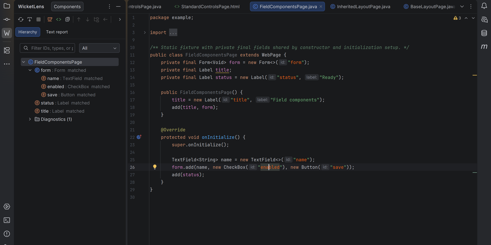
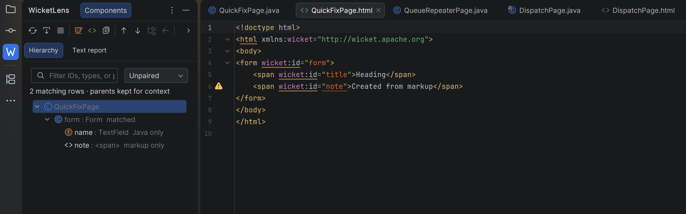
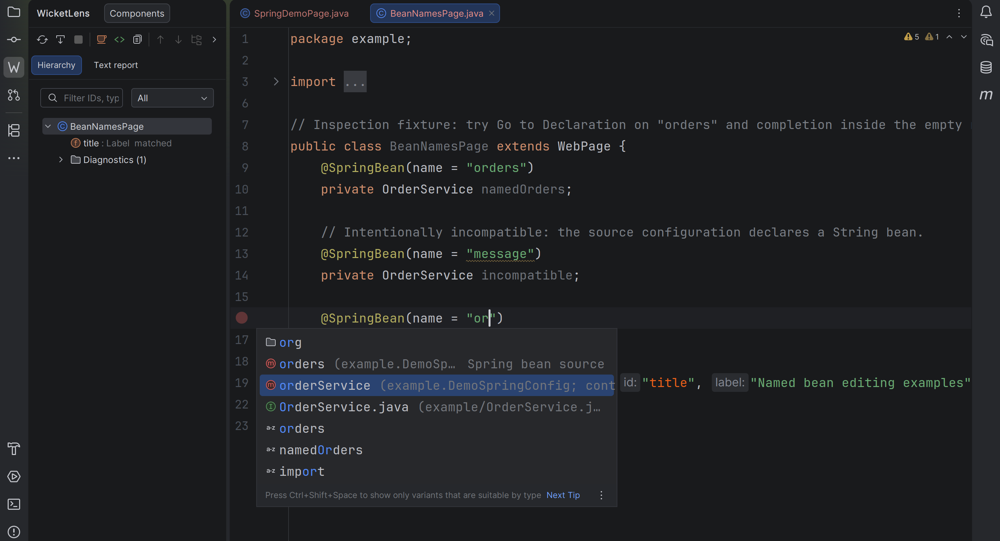
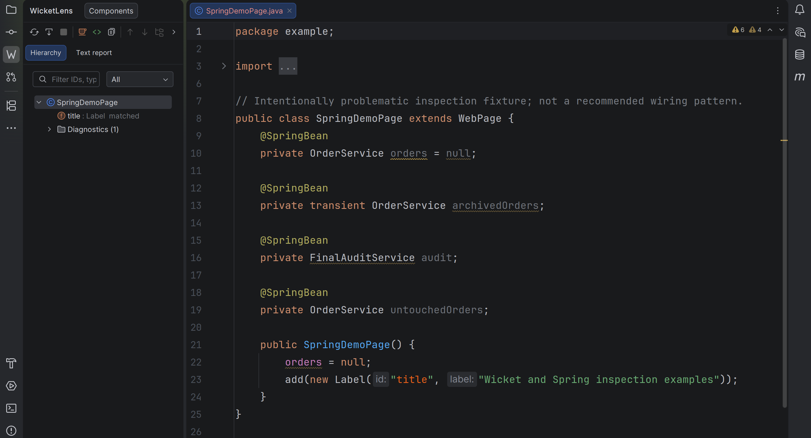
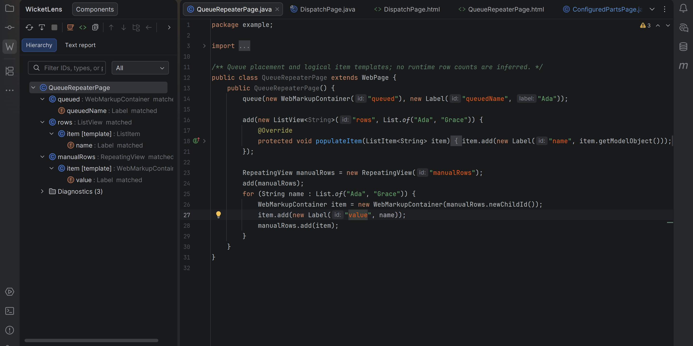
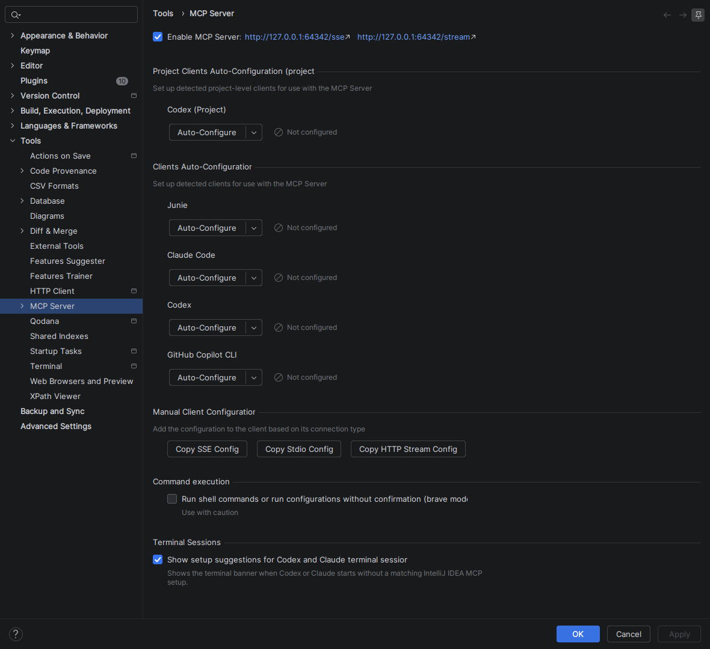
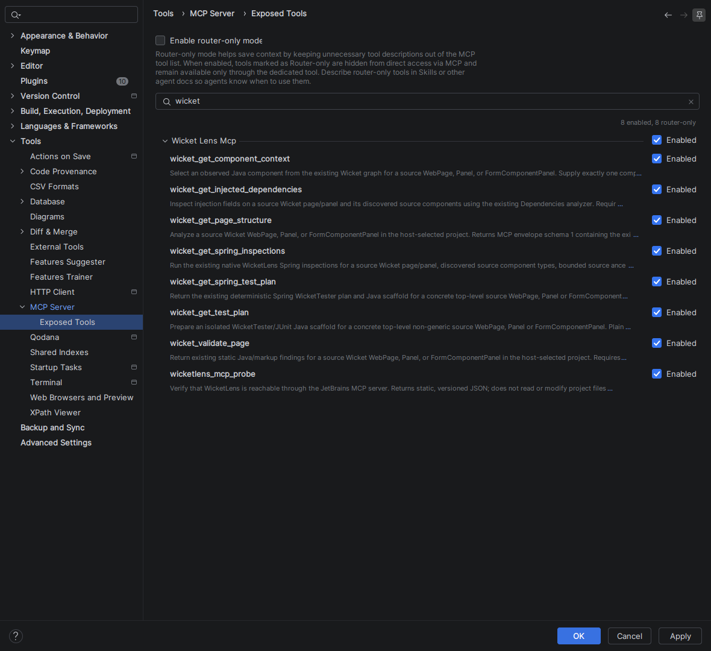

# WicketLens

**See how your Apache Wicket Java components connect to their HTML markup.**

WicketLens is an IntelliJ IDEA plugin that puts a Wicket component hierarchy beside
your editor. Follow a component from Java to `wicket:id` and back, spot missing
pairs, and explore how a page is assembled without running the application.
Optional Spring tools help you inspect injected dependencies and scaffold tests.
Through IntelliJ's MCP server, coding agents can query the component graph and
Java/HTML binding findings.

[Project website](https://danielbartl.github.io/wicketlens/)

## Features

- **A Wicket-aware sidebar.** Follows the active Java or HTML file and shows nested
  components, types, matching status, and explanations for uncertain results.
- **Java ↔ HTML navigation.** Jump between paired IDs from the editor or hierarchy.
  Completion suggests unused IDs under the matching parent.
- **Editor feedback.** Possible missing pairs appear in inspections, the Problems
  view, and the gutter. Configurable Wicket-orange highlighting makes IDs easier to spot.
- **Safer ID edits.** Preview paired Java/HTML renames and use quick fixes to correct
  IDs or create basic counterparts, with native undo and conservative scope checks.
- **Explore larger pages.** Search IDs, types, and paths; filter findings; focus a
  subtree; step through findings with F2 / Shift+F2. Keep your place after reanalysis.
- **Beyond direct additions.** Analyze supported fields, constant expressions, helpers, factories,
  inheritance, custom inputs, queueing, and repeater item templates.
  Supported constants can also come from dependency JARs and the JDK.
- **Copy context.** Export the complete analyzed page as structured JSON for debugging,
  documentation, or use with your own tools. Analysis runs locally.
- **Agent integration (preview).** Share read-only page structure, binding findings,
  component context, and injected dependencies (including profiles and FactoryBeans)
  with Codex or Claude through IntelliJ's built-in MCP server. Agents can also
  query native Spring inspection findings with configured severity and suppression.
  See [setup and compatibility](docs/mcp-client-setup.md).
- **Optional Wicket–Spring support.** Spot possible injection and serialization
  mistakes and missing application setup, complete named beans, and jump to source
  declarations. Candidate details show declared profiles and generic `FactoryBean`
  products, including `&name` factory lookups. Checks require evidence of
  Wicket–Spring usage and work without IntelliJ's Spring plugin.
  See [the supported scope](docs/spring-integration.md).
- **Inspect injected dependencies.** The Dependencies tab groups injection fields
  and source bean candidates by component. Search fields, types, and aliases, then
  navigate to the field or bean declaration.
- **Spring test scaffolding.** Preview a Java WicketTester test with an isolated
  Spring context, JUnit Jupiter, and Mockito mocks. Copy it or create it in an
  existing test root, with preview, undo, and explicit TODOs for manual setup.

## Screenshots

**Explore components beside their Java source.** Fields and initialization setup
appear in one hierarchy, with form children grouped under their parent.



**Find missing pairs.** The Unpaired filter keeps parent context while showing
Java-only and markup-only IDs. The HTML editor highlights IDs and marks the finding in the gutter.



**Complete Spring bean names.** Suggestions include compatible source declarations
and aliases. The popup labels source candidates without claiming a runtime binding.



<details>
<summary>More examples: Spring inspections, queues, repeaters, and MCP setup</summary>

**Review Spring wiring.** The example highlights possible overwritten injections,
transient dependency storage, and a final class that cannot use Wicket's subclass proxy.



**Inspect queues and repeaters.** See queued placement and logical item templates
for supported ListView and RepeatingView patterns.



**Enable agent access in the IDE.** WicketLens uses the bundled MCP Server and
its normal client configuration controls.



</details>

## Installation

WicketLens is not on JetBrains Marketplace yet. Install a plugin ZIP built from
this repository, or use a prebuilt ZIP if one is supplied with a release.

### Build the ZIP

Download or clone this repository, select a **Java 25 JDK**, and run from the
repository root:

```bash
./gradlew buildPlugin
```

On Windows, use `gradlew.bat buildPlugin`. The wrapper downloads Gradle and the
required build dependencies on the first run.

The current archive is `build/distributions/wicketlens-0.1.0-SNAPSHOT.zip`.

### Install in IntelliJ IDEA

1. Open **Settings → Plugins**.
2. Open the settings menu (gear icon) and choose **Install Plugin from Disk…**.
3. Select the plugin ZIP without extracting it.
4. Apply the changes and restart IntelliJ IDEA if prompted.

See JetBrains' [installation instructions](https://www.jetbrains.com/help/idea/managing-plugins.html#install_plugin_from_disk).
To update a local installation, build or obtain a newer ZIP and install it the same way.

**Verified compatibility:** IntelliJ IDEA **2026.2.3** (build **262.10968.63**) with
Wicket **10.11.0**. Other IDE/Wicket combinations have not been verified.

## Getting started

1. Open a Wicket project with its dependencies resolved.
2. Open **View → Tool Windows → WicketLens**, then select a Java `WebPage`, `Panel`,
   or `FormComponentPanel`, or its uniquely paired HTML companion.
3. Keep **Follow editor** enabled to follow the current file, or use
   **Tools → Analyze Wicket Page** explicitly.
4. Select a component to navigate to Java or HTML. After edits, use **Re-analyze**
   to refresh the sidebar snapshot.

To try the included examples, open [examples/demo/pom.xml](examples/demo/pom.xml)
as a Maven project. The demo contains forms, custom inputs, inherited markup,
provider factories, queues, and repeaters.

For the optional Spring inspections, import the separate
[Spring demo](examples/spring-demo/pom.xml), which contains intentional findings.
Open `BeanNamesPage.java` to try Basic Completion in a bean-name literal or
Go to Declaration on an alias. Configure checks under
**Settings → Editor → Inspections → WicketLens**; the sidebar need not be open.
Use the sidebar's **Dependencies** tab to inspect injection fields and navigate
their source candidates; see [the view guide](docs/injected-dependencies.md).

Choose **Tools → Generate Wicket Spring Test…** to preview a test for a supported
page or component. The [test-scaffolding guide](docs/spring-testing.md) explains
the generated hooks and required test dependencies; a
[runnable Spring test demo](examples/spring-test-demo/pom.xml) is included.

## Use with Codex or Claude Code

Connect your agent to inspect page structure, explain Java/HTML binding findings,
or retrieve a component's parent, children, and source locations. The WicketLens
tools return static analysis and uncertainty without modifying project files.

1. Enable **Settings → Tools → MCP Server** in IntelliJ IDEA.
2. Open **Exposed Tools**, search for `wicket`, and check that the six WicketLens
   entries are enabled and available for direct calls.
3. Connect your client using the IDE's HTTP Stream configuration, then supply
   the open project, qualified Java class, and module when needed.



The screenshot shows the earlier preview. The updated plugin also exposes
[`wicket_get_injected_dependencies`](docs/mcp-injected-dependencies.md) for source
injection fields, profile conditions, and FactoryBean product/factory candidates.
[`wicket_get_spring_inspections`](docs/mcp-spring-inspections.md) returns native
Spring warnings while respecting the current inspection profile and suppression.

Graphical setup and actual calls are verified with **Codex CLI 0.166.0** and
**Claude Code 2.1.314** on the IDE build above. See the
[setup guide](docs/mcp-client-setup.md) for configuration examples, the demo
request, and known host timeout/cancellation limitations. This integration is a
preview; model values and runtime behavior are not inspected.

## Scope and documentation

WicketLens is an early-stage static analysis plugin. It reports supported bindings
and explains uncertainty when it cannot prove a relationship. Dynamic application
code and runtime behavior can remain unresolved; real application accuracy and
performance evaluation is still pending.

- [Landing page](site/README.md) — local preview and manual GitHub Pages publication.
- [Developer guide](docs/developer-guide.md) — build, sandbox, usage, supported patterns, and troubleshooting.
- [Hierarchy exploration](docs/hierarchy-exploration.md) — search, filters, focus, and finding navigation.
- [Wicket–Spring support](docs/spring-integration.md) — inspections, bean-name editing, and evidence limits.
- [Spring test scaffolding](docs/spring-testing.md) — generate, review, and adapt an isolated WicketTester test.
- [MCP setup](docs/mcp-client-setup.md) — graphical setup, Codex/Claude configuration and troubleshooting; [implementation roadmap](docs/mcp-integration.md).
- [Preview release checklist](docs/release-checklist.md) — artifact checks, retained test evidence and publication boundaries.
- [Analysis and verification record](docs/acceptance.md) — test evidence and compatibility limits.
- [Project specification](spec.md) — scope and future possibilities.

## License

WicketLens is licensed under the [Apache License 2.0](LICENSE).
