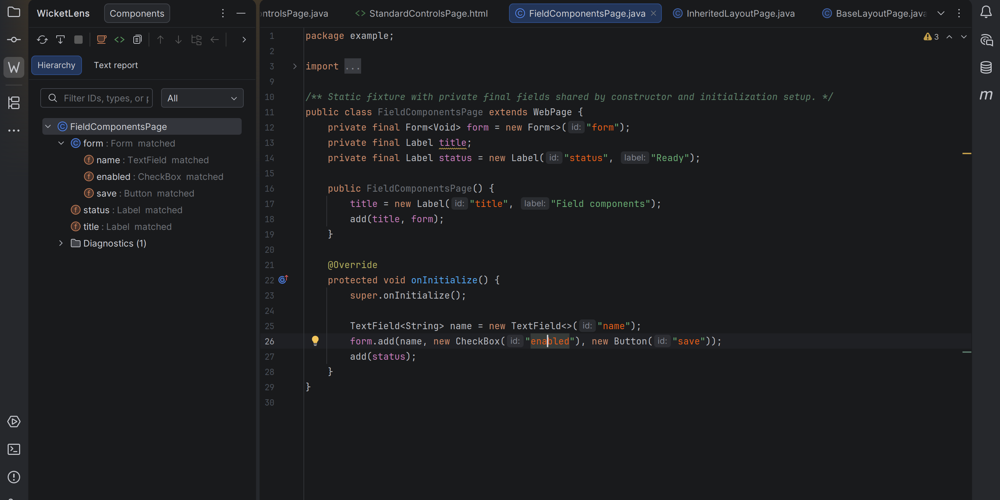
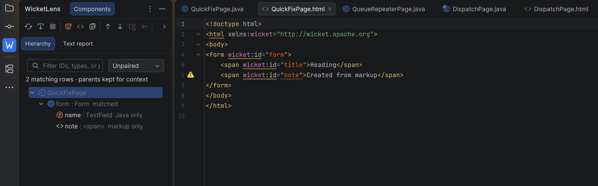
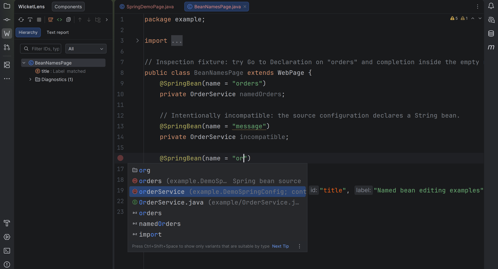
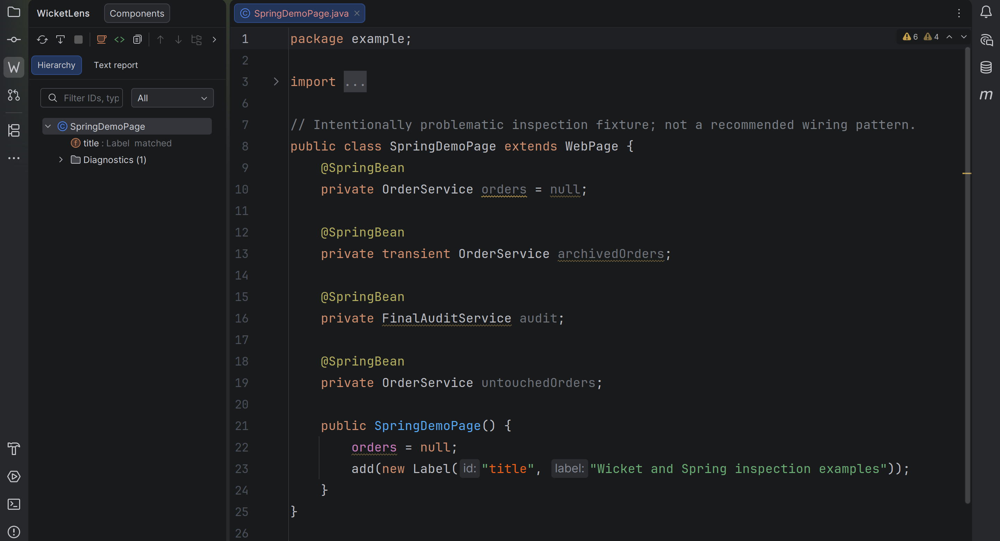
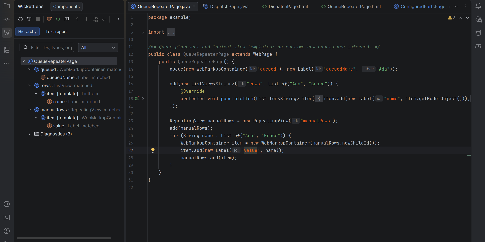
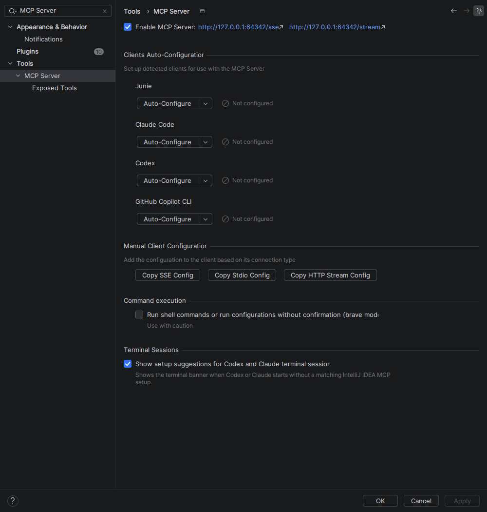
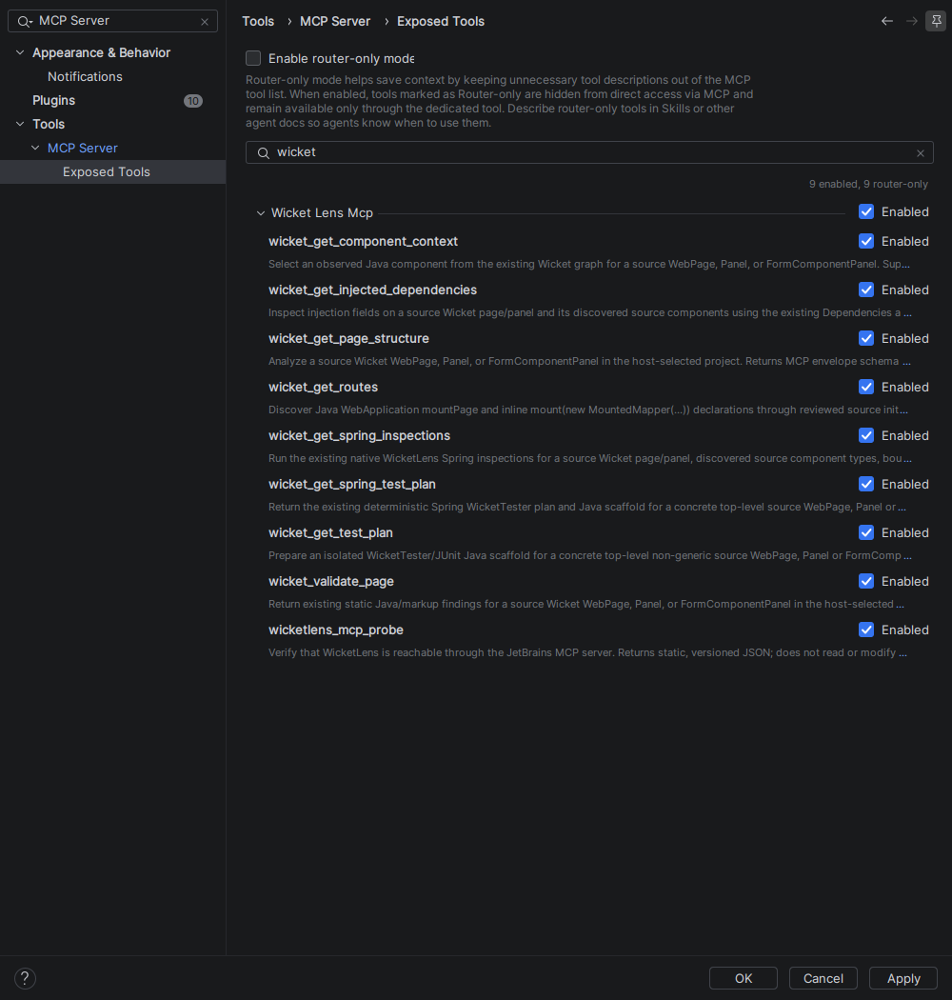

# WicketLens

**See how your Apache Wicket Java components connect to their HTML markup.**

WicketLens is an IntelliJ IDEA plugin that puts a Wicket component hierarchy beside
your editor. Follow a component from Java to `wicket:id` and back, spot missing
pairs, and explore how a page is assembled without running the application.
Optional Spring tools help you inspect injected dependencies and scaffold tests.
Through IntelliJ's MCP server, coding agents can query the component graph and
Java/HTML binding findings.

[Project website](https://danielbartl.github.io/wicketlens/)

## Settings

Open **Settings → Tools → WicketLens** to enable **Show text report (debugging)**.
The debugging text tab is hidden by default. Changes apply immediately and are
saved across IDE sessions. See [the settings notes](docs/plugin-settings.md).

## Features

- **A Wicket-aware sidebar.** Follows the active Java or HTML file and shows nested
  components, types, matching status, and explanations for uncertain results.
- **Mounted URLs.** Browse page, package and resource mounts across source
  applications. Follow local mappers, closed helpers, factories and reviewed
  root changes, and see possible fixed-path conflicts. Click a page path to
  open the Java source. MCP exposes the same declarations through
  `wicket_get_routes`. [Routing coverage](docs/mounted-urls.md)
- **Spring Beans.** Find Spring injection fields across Wicket components and
  click a row to open the declaration. An orange **W** at the field opens the
  corresponding source bean definition or offers a chooser. See [supported
  scope and usage](docs/injected-dependencies.md).
- **Java ↔ HTML navigation.** Ctrl-click a Wicket ID to open its counterpart or
  choose among possible matches in the companion file. Ctrl+Space suggests
  unused IDs under the known parent and labels companion-file suggestions
  **possible** when the parent scope is incomplete. [Editor behavior](docs/context-completion.md)
- **Companion files.** Use **Switch Wicket Java/Markup** from the editor or
  **Tools** to open a companion file and choose among known HTML variants.
  **Create Wicket Markup** scaffolds missing HTML for an existing class.
  In a Java package in the Project view, use **New → Wicket Page** or
  **New → Wicket Panel** to create both files in one undoable operation.
- **Localization keys.** Use Ctrl+Space or Go to Declaration in
  `<wicket:message key="…">`, a key in `wicket:message="attribute:key"`, a Wicket
  `ResourceModel` or `StringResourceModel` constructor, or a call such as
  `panel.getString("title")`. In Java, place the caret in the key literal. For `getString`, keys come from the
  receiver's conventional component bundle and its variants. Use **Compare Wicket
  Bundle Keys** to review translation coverage.
- **Resource editing.** In the full Java **Rename** dialog, select **Rename
  Wicket companion files** to review matching HTML and properties filenames.
  Select plain HTML text or a Java Wicket Label's text literal, then use
  **Extract Text to Wicket Bundle** to localize it in one undoable edit.
  Renaming a matched component ID can update shared bindings and path-qualified
  properties keys in the same preview.
- **WicketTester paths.** Use **Copy WicketTester Component Path** from the
  Components hierarchy for a concrete path such as `form:title`.
- **Project tree markers.** A small orange dot on the existing class icon marks
  Wicket pages, panels, and components, including custom base classes, without
  adding text to the filenames. See [the supported scope](docs/project-tree-markers.md).
- **Editor feedback.** Possible missing pairs appear in inspections, the Problems
  view, and the gutter. Configurable Wicket-orange highlighting makes IDs easier to spot.
- **Safer ID edits.** Preview paired Java/HTML renames and use quick fixes to correct
  IDs or create basic counterparts, with native undo and conservative scope checks.
- **Explore larger pages.** Search IDs, types, and paths; filter findings; focus a
  subtree; step through findings with F2 / Shift+F2. Keep your place after reanalysis.
- **Beyond direct additions.** Analyze supported fields, constant expressions, helpers, factories,
  inheritance, custom inputs, queueing, and repeater item templates.
  Supported constants can also come from dependency JARs and the JDK.
  Also confirms common bounded `if/else` and ternary structure,
  including computed IDs, keeping optional components conditional, all source
  origins and conservative editing guards.
  Recognizes complementary checks of stable boolean flags and their aliases.
  Reviewed compound `&&`/`||` checks also share those input facts.
  Primitive boolean equality and eager `&`/`|`/`^` checks preserve them after
  auditing every required operand.
  Stable integral comparisons share complementary and equivalent threshold facts
  without inferring runtime numbers.
  Combines per-input bounds and excluded values to remove impossible setup paths.
  Checks queue placement on each feasible setup path; optional queues stay conditional.
  Merges reviewed repeater templates across branches, retaining inferred item
  bindings and uncertainty about optional children and runtime rows.
- **Copy context.** Export the complete analyzed page as structured JSON for debugging,
  documentation, or use with your own tools. Analysis runs locally.
- **Development source component layouts.** Resolve ordinary bindings through decorated
  components, constructor delegation, inherited initialization and transparent
  markup. Component-owned contents and unsupported effects retain uncertainty.
  See [the supported scope and corpus checks](docs/source-layouts.md).
  [Fragment definitions](docs/fragments.md) now support inherited lookup, proved
  instance contents, and navigation to shared definitions.
  [Bounded source factories](docs/factories.md) compose owned component markup
  and inferred repeated templates, including Inbox split panes and mail rows.
  [Named nested companions and navigation contexts](docs/nested-navigation.md)
  pair binary-name resources and expose bounded caller/inheritor targets in
  native references and optional MCP structure discovery.
  [Owned form-field summaries](docs/owned-form-fields.md) confirm ordinary wrapper
  bindings through metadata and lazy inputs while keeping their internals opaque.
  [ID origin-use auditing](docs/id-origin-audit.md) enables paired rename for
  isolated identity-only literals, retaining guards for shared and data uses.
  [Constructor-reference editor contexts](docs/replacement-editors.md) expose
  declared replacement routes as separate event templates in native navigation
  and optional MCP discovery.
  [Registered wizard selections](docs/wizard-selections.md) expose separate step
  templates with source order and unknown current selection.
  [Tree node templates](docs/tree-populations.md) resolve node/content declarations
  with explicit conditional parents and unknown runtime ancestry.
  [Lazy composite form internals](docs/form-inputs.md) expose input structure and
  conversion/validation source locations while leaving runtime results unknown.
  [Registered custom composite inputs](docs/registered-form-inputs.md) add source
  constructor-reference provenance and wrapper-relative phone input children.
  [Direct base-layout analysis](docs/base-layouts.md) reconciles constructor entries
  and shows an inferred shell around an explicitly unknown extension slot.
  [Conditional list populations](docs/list-populations.md) follow leaf/group rows,
  shared helpers and nested item scopes while keeping runtime state unknown.
  [Immediate content factories](docs/content-factories.md) follow table toolbar
  replacement declarations and nested form fields in separate source templates.
  [Lazy table toolbar content](docs/table-toolbars.md) follows cached empty-state
  toolbars and owned labels with toolbar-relative paths and unknown runtime IDs.
  [Registered list callbacks](docs/registered-list-callbacks.md) follow source
  item/data factory bridges and behavior-decorated default items, including
  AccordionPage's title/content template.
  [Initial dialog content](docs/initial-dialog-content.md) follows guarded
  dialog/drawer slots and initial fragments as inferred source declarations,
  keeping later open/close effects unknown.
  [Row-triggered drawer content](docs/event-dialog-content.md) adds separate event
  templates for fresh fragments supplied by an Ajax row link; the initial page
  and unknown runtime state remain explicit.
  [Dialog submission templates](docs/submission-templates.md) link owned confirm
  buttons to source callbacks, declared Ajax targets and fresh content placements
  in separate inferred contexts, keeping validation and save/delete outcomes unknown.
  [Ordinary form submissions](docs/form-submission-templates.md) expose separate
  submit/error declarations, feedback receivers and Ajax targets, including
  InvoicePage, while retaining uncertainty about its initial hierarchy and outcomes.
  Wicket ID popups exclude generic string suggestions from other scopes and
  preserve transparent layout lookup while editing an incomplete ID.
  [Constructor data-loop auditing](docs/constructor-data-loops.md) now recognizes
  isolated counted data seeding without evaluating rows or model values, and
  exposes the next blocking construction effect when the full layout is withheld.
  [Constructor-owned dialog content](docs/constructor-owned-dialog-content.md)
  adds inferred message declarations and constructor placement sources for
  confirmation dialogs, with later actions and model/visibility effects unknown.
- **Agent integration (preview).** Share read-only page structure, binding findings,
  component context, and injected dependencies (including profiles and FactoryBeans)
  with Codex or Claude through IntelliJ's built-in MCP server. Agents can also
  query native Spring inspection findings with configured severity and suppression.
  See [setup and compatibility](docs/mcp-client-setup.md).
- **Optional Wicket–Spring support.** Spot possible injection and serialization
  mistakes and missing application setup, complete named beans, and jump to source
  declarations. Candidate details show declared profiles and generic `FactoryBean`
  products, including `&name` factory lookups. Checks require evidence of
  Wicket–Spring usage and work without IntelliJ's Spring plugin.
  See [the supported scope](docs/spring-integration.md).
- **Inspect injected dependencies.** The Dependencies tab groups injection fields
  and source bean candidates by component. Search fields, types, and aliases, then
  navigate to the field or bean declaration.
- **Spring test scaffolding.** Preview a Java WicketTester test with an isolated
  Spring context, JUnit Jupiter, and Mockito mocks. Copy it or create it in an
  existing test root, with preview, undo, and explicit TODOs for manual setup.
  The [agent-assisted demo workflow](examples/spring-test-demo/AGENT_WORKFLOW.md)
  demonstrates MCP context, normal edits/tests, and a disposable regression check.
  Includes [plain-Wicket planning](docs/wicket-test-planning.md) without Spring or
  Mockito and a [complex Spring example](examples/spring-test-demo/COMPLEX_WORKFLOW.md).

## Screenshots

**Explore components beside their Java source.** Fields and initialization setup
appear in one hierarchy, with form children grouped under their parent.



**Find missing pairs.** The Unpaired filter keeps parent context while showing
Java-only and markup-only IDs. The HTML editor highlights IDs and marks the finding in the gutter.



**Complete Spring bean names.** Suggestions include compatible source declarations
and aliases. The popup labels source candidates without claiming a runtime binding.



<details>
<summary>More examples: Spring inspections, queues, repeaters, and MCP setup</summary>

**Review Spring wiring.** The example highlights possible overwritten injections,
transient dependency storage, and a final class that cannot use Wicket's subclass proxy.



**Inspect queues and repeaters.** See queued placement and logical item templates
for supported ListView and RepeatingView patterns.



**Enable agent access in the IDE.** WicketLens uses the bundled MCP Server and
its normal client configuration controls.



</details>

## Release

**WicketLens 0.1.0** is the first final release. It includes component exploration,
Java/HTML editor tools, optional Spring inspections and dependency context,
WicketTester planning, Mounted URLs and nine read-only MCP tools. The fixtures
and demos now use Wicket 11.0.0.
See [release notes, verification and scope](docs/releases/0.1.0.md).
Earlier candidates and previews remain available in GitHub Releases.

## Installation

Download the ready-to-install
[WicketLens 0.1.0 ZIP](https://github.com/danielbartl/wicketlens/releases/download/v0.1.0/wicketlens-0.1.0.zip)
from [GitHub Releases](https://github.com/danielbartl/wicketlens/releases/tag/v0.1.0).
The release also provides [SHA256SUMS.txt](https://github.com/danielbartl/wicketlens/releases/download/v0.1.0/SHA256SUMS.txt) to verify the archive.
No local build or separate JDK installation is needed to install it. WicketLens
is not on JetBrains Marketplace yet.

### Install in IntelliJ IDEA

1. Open **Settings → Plugins**.
2. Open the settings menu (gear icon) and choose **Install Plugin from Disk…**.
3. Select the downloaded plugin ZIP without extracting it.
4. Apply the changes and restart IntelliJ IDEA if prompted.

See JetBrains' [installation instructions](https://www.jetbrains.com/help/idea/managing-plugins.html#install_plugin_from_disk).
To update a local installation, build or obtain a newer ZIP and install it the same way.

**Verified compatibility:** IntelliJ IDEA **2026.2.3** (build **262.10968.63**) with
Wicket **11.0.0** fixtures and demos. The demos target Java 21, Servlet 6.1 and
Spring 7. Earlier RC 1 checks used Wicket 10.11.0. See the [upgrade review and verification](docs/wicket-11-upgrade.md).
Other IDE/Wicket combinations have not been verified.

### Build from source (optional)

Download or clone this repository, select a **Java 25 JDK**, and run from the
repository root:

```bash
./gradlew buildPlugin
```

On Windows, use `gradlew.bat buildPlugin`. The wrapper downloads Gradle and the
required build dependencies on the first run.

The current archive is `build/distributions/wicketlens-0.1.0.zip`.

## Getting started

1. Open a Wicket project with its dependencies resolved.
2. Open **View → Tool Windows → WicketLens**, then select a Java `WebPage`, `Panel`,
   or `FormComponentPanel`, or its uniquely paired HTML companion.
3. Keep **Follow editor** enabled to follow the current file, or use
   **Tools → Analyze Wicket Page** explicitly.
4. Select a component to navigate to Java or HTML. After edits, use **Re-analyze**
   to refresh the sidebar snapshot.

To try the included examples, open [examples/demo/pom.xml](examples/demo/pom.xml)
as a Maven project. The demo contains forms, custom inputs, inherited markup,
provider factories, queues, and repeaters.

For the optional Spring inspections, import the separate
[Spring demo](examples/spring-demo/pom.xml), which contains intentional findings.
Open `BeanNamesPage.java` to try Basic Completion in a bean-name literal or
Go to Declaration on an alias. Configure checks under
**Settings → Editor → Inspections → WicketLens**; the sidebar need not be open.
Use the sidebar's **Dependencies** tab to inspect injection fields and navigate
their source candidates; see [the view guide](docs/injected-dependencies.md).

Choose **Tools → Generate Wicket Spring Test…** to preview a test for a supported
page or component. The [test-scaffolding guide](docs/spring-testing.md) explains
the generated hooks and required test dependencies; a
[runnable Spring test demo](examples/spring-test-demo/pom.xml) is included.

## Use with Codex or Claude Code

Connect your agent to inspect page structure, explain Java/HTML binding findings,
or retrieve a component's parent, children, and source locations. The WicketLens
tools return static analysis and uncertainty without modifying project files.

1. Enable **Settings → Tools → MCP Server** in IntelliJ IDEA.
2. Open **Exposed Tools**, search for `wicket`, and enable the WicketLens
   entries available in your installed version for direct calls.
3. Connect your client using the IDE's HTTP Stream configuration, then supply
   the open project, qualified Java class, and module when needed.



The release and screenshot include
[`wicket_get_injected_dependencies`](docs/mcp-injected-dependencies.md) for source
injection fields, profile conditions, and FactoryBean product/factory candidates.
[`wicket_get_spring_inspections`](docs/mcp-spring-inspections.md) returns native
Spring warnings while respecting the current inspection profile and suppression.

RC 1 includes two read-only planning tools:
[`wicket_get_spring_test_plan`](docs/mcp-spring-test-plan.md) returns the existing
Spring scaffold, dependencies and manual setup TODOs.
[`wicket_get_test_plan`](docs/wicket-test-planning.md) handles plain Wicket and
selects that Spring recipe only when injection/application intent is recognized.
Neither tool creates files or runs tests. The general planner is also available
through **Tools → Generate Wicket Test…**.

The development build adds **Generate Wicket Mounted Test…** in Mounted
URLs. Select a page mount to test parameter binding with your own sample values,
including omitted optional parameters. Reviewed Wicket session and auth-roles
declarations add session and sign-in tests. Fixed resource plans can check the
media type and response digest. The shared planner also links injected fields to
generated mocks or manual setup. [Wicket test planning](docs/wicket-test-planning.md)

Graphical setup and actual calls are verified with **Codex CLI 0.166.0** and
**Claude Code 2.1.317** on the IDE build above. See the
[setup guide](docs/mcp-client-setup.md) for configuration examples, the demo
request, and known host timeout/cancellation limitations. This integration is a
preview; model values and runtime behavior are not inspected.

## Scope and documentation

WicketLens is an early-stage static analysis plugin. It reports supported bindings
and explains uncertainty when it cannot prove a relationship. Dynamic application
code and runtime behavior can remain unresolved; real application accuracy and
performance evaluation is still pending.

- [Landing page](site/README.md) — local preview and manual GitHub Pages publication.
- [Developer guide](docs/developer-guide.md) — build, sandbox, usage, supported patterns, and troubleshooting.
- [Hierarchy exploration](docs/hierarchy-exploration.md) — search, filters, focus, and finding navigation.
- [Wicket–Spring support](docs/spring-integration.md) — inspections, bean-name editing, and evidence limits.
- [Spring test scaffolding](docs/spring-testing.md) — generate, review, and adapt an isolated WicketTester test.
- [MCP setup](docs/mcp-client-setup.md) — graphical setup, Codex/Claude configuration and troubleshooting; [implementation roadmap](docs/mcp-integration.md).
- [Release checklist](docs/release-checklist.md) — artifact checks, retained test evidence and publication boundaries.
- [Analysis and verification record](docs/acceptance.md) — test evidence and compatibility limits.
- [Project specification](spec.md) — scope and future possibilities.

## License

WicketLens is licensed under the [Apache License 2.0](LICENSE).

Development column-construction scope and MCP behavior are documented in the
[storage-only column contract](docs/column-construction.md).

The next source-column boundary is described in the
[LambdaColumn constructor contract](docs/lambda-columns.md).

Reviewed JDK enum defaults and the next provider boundary are documented in the
[date-column enum contract](docs/date-column-enums.md).

Source provider allocation and callback uncertainty are documented in the
[provider construction contract](docs/provider-construction.md).

Reviewed DataTable construction, eager-factory guards and the next toolbar boundary
are documented in the [DataTable contract](docs/datatable-construction.md).

Fresh table/header-toolbar construction and registration are documented in the
[toolbar registration contract](docs/toolbar-registration.md).

Navigation-toolbar construction now reviews its eager paging factory under the
existing fresh-table registration proof. Later paging-link initialization and
provider/model queries stay unknown. See [the contract](docs/navigation-toolbar-construction.md).

Owned component accessors can now support guarded literal attribute decoration
through a fresh local owner. Private child identities and runtime behavior remain
unexpanded. See [the contract](docs/owned-component-accessors.md).

Fresh inline fluent component configuration now supports guarded source enum
storage through private behaviors and exact Models. Runtime values and callbacks
stay unknown. See [the contract](docs/fluent-component-configuration.md).

The [owned table-reference forwarding contract](docs/owned-table-forwarding.md)
records the next guarded Oat construction boundary and its native/MCP acceptance.

The [deferred columns-read contract](docs/table-columns-read.md) records guarded
immutable-list size reads and their native/MCP acceptance.

The [owned toolbar cache contract](docs/owned-toolbar-cache.md) records guarded
cache assignment/registration and native/MCP acceptance.

Declaration-scan reuse now lets the original DataTablePage complete initial source
setup within the unchanged work budget: 26 inferred matches and 9 branch findings.
Default native/MCP views share the result. The optional combined page/navigation
response retains its 512-KiB bound and currently returns RESPONSE_TOO_LARGE for this
page. See [the declaration-work contract](docs/declaration-work.md).

The thirty-seventh development milestone adds `wicket_get_navigation_contexts`:
list a compact index, then retrieve one exact existing navigation projection by
its snapshot-bound contextId. This makes all seven DataTablePage contexts
available within the unchanged 512-KiB cap. Existing tool defaults, schemas,
semantic uncertainty and native discovery bounds are preserved. See
[the retrieval contract](docs/mcp-navigation-contexts.md).

Initial table attachments on plain pages now survive a reviewed fresh source
registrar that only stores its inline action callback. Bindings remain inferred;
later dispatch/tree state and outcomes remain unknown. Native and MCP share the
storage provenance. See [the contract](docs/stored-action-attachments.md).

Repeated action registrations through the same fresh local now share a complete
storage-use audit while keeping independent inferred source contexts. Active
callback/dispatch state stays unknown. See [the contract](docs/repeated-action-registrations.md).

Standalone fluent action-registration chains now retain inferred source targets
and distinct per-link locations after a complete receiver-return and use audit.
Active callback/dispatch state stays unknown. See [the contract](docs/chained-action-registrations.md).

Fresh registrar allocations can now initialize constructor locals through reviewed
registration chains. Initializer links and later uses share one complete audit;
active callbacks and outcomes stay unknown. See [the contract](docs/initialized-action-registrations.md).
