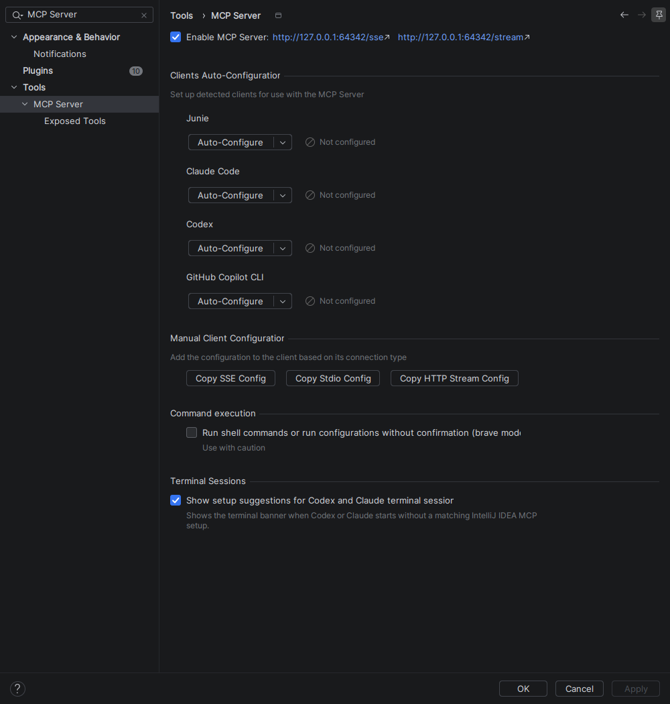
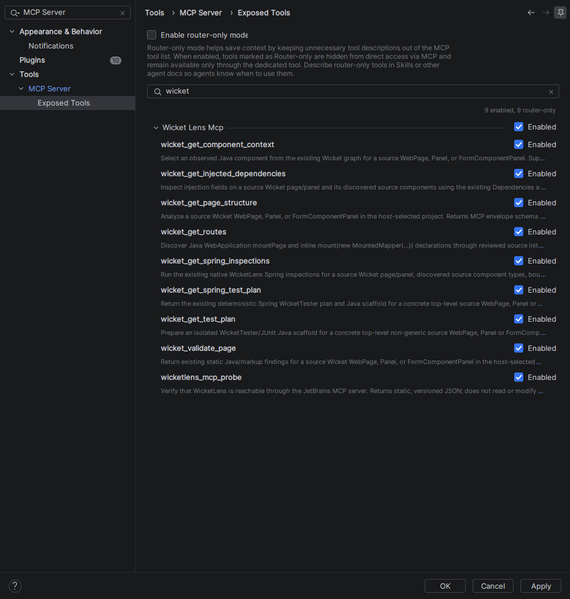

# Connect an agent to WicketLens

WicketLens **0.1.0** contributes nine read-only tools to IntelliJ IDEA's
bundled MCP server. Install the plugin using [the ZIP instructions](../README.md#installation)
and open a Wicket project with Java/resource roots and resolved dependencies.
No separate WicketLens server, AI subscription inside the IDE, or Spring plugin
is required. Your chosen agent has its own account/model configuration.

RC 1 adds [`wicket_get_routes`](mcp-routes.md) for the project-wide Mounted URLs
browser. Preview 2 has eight tools; omit routes from its allowlist. Preview 1 has
six tools; also omit both planning tools. The graphical/client evidence below
records the RC 1 production bytecode, retained unchanged in final 0.1.0.
Final artifact verification is in the [release checklist](release-checklist.md);
earlier evidence remains at the corresponding preview Git tags.

The source checkout now uses [Wicket 11 fixtures](wicket-11-upgrade.md), with
Java 21 demo/MCP project settings, Spring 7 and Servlet 6.1. Tool names, schemas
and client setup are unchanged. Graphical/client evidence below retains the
published RC 1 record alongside the new automated framework checks.

## Enable the graphical server

1. Check **Settings → Plugins → Installed**: WicketLens and **MCP Server** must
   be enabled. Restart after installing/updating the ZIP if prompted. When using
   the development sandbox, an already running IDE can retain an older plugin
   even after Gradle copies a new JAR; exit and relaunch that sandbox.
2. Open **Settings → Tools → MCP Server**, enable the server, review the IDE's
   access dialog, and apply the change.
3. Open **Exposed Tools**, search for `wicket`, and verify the enabled entries
   below for your installed version. For direct tool calls with the client allowlists in this
   guide, leave **Enable router-only mode** off in the verified build.
4. Copy the **HTTP Stream** configuration, or use the `/stream` address shown
   beside the enable checkbox. Use your IDE's displayed URL; the graphical
   sandbox here used port `64342`, while the headless development harness uses
   `64343`. Restart/reconnect the client after changing its configuration.

This flow was exercised on the pinned IDE. JetBrains also documents
[server enablement, configuration copying and tool exposure](https://www.jetbrains.com/help/idea/mcp-server.html).
The command-execution “brave mode” setting is not needed for these read-only
WicketLens tools and remained off during verification.





The RC walkthrough verifies all nine tools in the graphical server.
Both Codex and Claude Code successfully invoke component context through this
server; [setup evidence](mcp-setup-evidence.json) identifies the current production
bytecode and screenshot hashes. The separate [Spring inspection verification](mcp-spring-inspections-evidence.json)
also covers configured severity and suppression, while [dependency verification](mcp-dependencies-evidence.json)
records its focused protocol and ephemeral Codex call.

| Tool | Purpose |
| --- | --- |
| `wicketlens_mcp_probe` | Check connectivity; fixed JSON, no semantic analysis. |
| `wicket_get_page_structure` | Existing component graph, matching, locations and uncertainty. |
| `wicket_validate_page` | Existing findings/diagnostics and summary counts. |
| `wicket_get_component_context` | Select a path/node; inspect parent, children and associated markup. |
| `wicket_get_injected_dependencies` | Injection fields, source bean candidates, profile conditions and FactoryBean products/instances. |
| `wicket_get_spring_inspections` | Native Spring findings, configured severity, source ranges and profile/suppression behavior. |
| `wicket_get_spring_test_plan` | Existing isolated Spring WicketTester plan/scaffold, dependency requirements and manual setup TODOs; no writes or execution. |
| `wicket_get_test_plan` | Plain Wicket/JUnit plan, or the same Spring recipe when injection/application intent is recognized. |
| `wicket_get_routes` | RC 1: Java mountPage/inline MountedMapper registrations through reviewed init inheritance and closed no-argument helpers; application/module groups, locations, setup paths and uncertainty. |

The IDE exposes other tools independently of WicketLens. The Codex allowlist
below exposes the nine RC 1 tools to that client.
Omit `wicket_get_routes` when using the released Preview 2 ZIP. Router-only tool workflows are
managed by the host; this guide verifies direct discovery and invocation.

## Codex

Add the following to your selected Codex configuration, replacing the URL with
the address copied from your IDE. Global `~/.codex/config.toml` and supported
project-scoped configuration use the same MCP table. Preserve existing entries.

```toml
[mcp_servers.wicketlens]
url = "http://127.0.0.1:64342/stream"
enabled_tools = [
  "wicketlens_mcp_probe",
  "wicket_get_page_structure",
  "wicket_validate_page",
  "wicket_get_component_context",
  "wicket_get_injected_dependencies",
  "wicket_get_spring_inspections",
  "wicket_get_spring_test_plan",
  "wicket_get_test_plan",
  "wicket_get_routes",
]
startup_timeout_sec = 20
tool_timeout_sec = 60
```

Restart the client and inspect `/mcp` in its TUI. The 60-second client timeout
allows the plugin's shorter deadline to finish; it does not extend that deadline
or fix the native host's session-expiry behavior. OpenAI documents these fields
and configuration scopes in its [official MCP guide](https://developers.openai.com/codex/mcp/).

For a temporary verification instead of saving configuration, see the
[ephemeral CLI example](mcp-integration.md#reproducing-the-spike), substituting
the graphical URL and desired semantic tool. The recorded walkthrough used
per-process overrides, an empty client folder, and no command/file tools.

## Claude Code

Claude Code can use the IDE's copied HTTP configuration. For example, merge this
entry into the chosen project's `.mcp.json`, or use its own MCP configuration UI:

```json
{
  "mcpServers": {
    "wicketlens": {
      "type": "http",
      "url": "http://127.0.0.1:64342/stream"
    }
  }
}
```

Use `/mcp` to inspect the connection and follow the client's project approval
flow. The `type` field is required for this HTTP entry. Anthropic documents
[HTTP configuration and scopes](https://code.claude.com/docs/en/mcp).
The acceptance call used temporary `--mcp-config` settings, only the context
tool permitted, no built-in tools, and no saved conversation or client settings.

## First requests

Start with the probe and supply `projectPath` as the exact open project root.
For Spring wiring, request `wicket_get_injected_dependencies` for the same
class/module. Read its source candidates and explicit profile/runtime uncertainty;
see [the dependency contract](mcp-injected-dependencies.md). The disposable
Spring fixture uses `example.McpPage` in module `mcp-spring`.
Request `wicket_get_spring_inspections` for native warnings on that page and its
reviewed source scope. Disabled/suppressed findings stay excluded and severity
follows the current IDE profile; see [the inspection contract](mcp-spring-inspections.md).
The host requires it even for the parameterless probe. Then ask the agent:

> Call `wicket_get_page_structure` with `projectPath` set to my open project,
> `className` set to `example.CustomerPage`, `moduleName` set to the exact IDE
> module, and `sourceSet` set to `main`. Explain findings and uncertainty.

Replace the class/module with your application. Supported roots are source
`WebPage`, `Panel`, and `FormComponentPanel` subclasses. Module selection is
optional when unambiguous. Sources in libraries are not root targets.

For the disposable development fixture, `example.McpPage`, module `mcp-fixture`,
and component path `form:name` select a matched TextField. Use that path with
`wicket_get_component_context`. Use a fresh graph `nodeId` for ambiguous IDs or
logical item templates. The tool contracts are linked in
[the integration guide](mcp-integration.md).

Development builds can confirm common structure across bounded unknown
`if/else` and ternary paths. Optional/conflicting typed parent paths remain conditional
variants with `conditional: true`, unresolved confidence and `UNRESOLVED_BRANCH`
findings; use node IDs when path selection is ambiguous.
Repeated stable boolean parameter/local checks and negation share invocation-local
path facts. Reviewed compound `&&`/`||` expressions retain relationships between
those stable inputs, including through aliases and accessors. Untracked
comparisons/calls and broader numeric constraints retain their existing
conservative contracts. Stable primitive boolean equality and eager `&`/`|`/`^`
now reuse input facts too, after auditing all required source operands. Effects,
boxed/reference equality and runtime flag values remain outside the contract.
Stable integral inputs compared with known constants now reuse canonical
threshold facts, including reversed/complementary and adjacent comparisons.
Primitive bounds are honored; runtime numbers, numeric identities and threshold
keys are not exported. Per-input intervals and excluded equality values now
connect thresholds and remove impossible setup paths. These ranges remain
internal, including singleton values. Distinct-input relations and symbolic
arithmetic remain outside the subset; no MCP field/tool or schema is added.
The facts themselves and the actual runtime flag values are not exported.
Known computed IDs can also match across branches. Computed-containing
components include `computedId: true` and typed `idOrigins` entries with
`location` and `LITERAL`/`COMPUTED` kind. A COMPUTED origin is the whole
expression; do not treat an equal-valued string fragment as the ID or apply a
literal rename to it. Mixed literal/expression alternatives retain both kinds.
Queues are resolved separately on each feasible setup path. Existing
`queuedInNodeId` and `parentNodeId` distinguish declaration from proven placement.
An optional queue stays unresolved even when its parent is known; changing or
ambiguous placements retain `UNRESOLVED_QUEUE`. Path membership/counts are internal
and are not exported. No additional tool or response schema is needed.
Reviewed repeater templates also merge across branches. Common children retain
`MATCHED`/`INFERRED` findings; optional children stay unresolved. Logical items
consume no segment in paths such as `rows:name` and have no runtime ID or row
count. Use a current node ID for overlapping repeater alternatives. Existing
template/repetition fields suffice; no new tool or response field is introduced.
The existing structure/context tools include `branchMerged`
and `javaLocations`/`idLocations` arrays for those components. Review all origins
before editing; `idRenameSafe: false` means a single-origin paired rename is not
supported. The runtime condition and captions remain unknown. See
[the branch contract](conditional-setup.md). RC 1 includes this extension; the
historical Preview 2 evidence certifies only its older artifact.

`status: ok` means the request completed. Findings remain static observations;
confidence, scope flags and causes still matter. Runtime model/property values
are unavailable. Responses contain source paths and findings that the connected
agent may send to its model provider according to that client's configuration.

## Troubleshooting

| Symptom | Check / recovery |
| --- | --- |
| MCP settings absent | Enable the bundled MCP Server plugin; confirm the exact supported IDE build. WicketLens remains usable without MCP. |
| IDE tools appear but WicketLens tools are missing | Confirm the plugin version, restart the IDE after replacing the ZIP, inspect Exposed Tools and direct/router settings, then reconnect. A stale sandbox process reproduced this symptom. |
| Connection refused or wrong server | Copy the address from the running IDE. `64343` belongs to the isolated headless harness, not the observed graphical server. |
| `AMBIGUOUS_CLASS` | Supply exact `moduleName` and `sourceSet`; also supply the intended open `projectPath`. |
| `CLASS_NOT_FOUND` / `UNSUPPORTED_TARGET` | Check the qualified Java class, Java roots, source set, Wicket dependency resolution and supported base type. |
| `COMPONENT_NOT_FOUND` / ambiguous path | Fetch structure again; use a current node ID instead of guessing a duplicate/dynamic path. |
| `STALE_SNAPSHOT` | Wait for edits/indexing to settle and invoke again. No outdated graph is returned. |
| `RESPONSE_TOO_LARGE` | Select a smaller component/root. Responses are rejected rather than truncated. |
| HTTP 404 after a long wait or cancellation | Reconnect the client and retry after the IDE is ready. This SDK can expire the session and suppress the tool's JSON error envelope. An absent response is not an empty or clean report. |
| Cancel button does not stop work immediately | Native wire cancellation is not prompt in the targeted SDK. Work remains bounded by the plugin's 30-second deadline/project disposal. See [the measured behavior](mcp-isolation-transport.md). |

## Verified compatibility

| Item | Evidence / limit |
| --- | --- |
| IntelliJ IDEA 2026.2.3, IU-262.10968.63 | Build/verifier, MCP-disabled tests, actual host tests and graphical settings walkthrough. |
| Bundled MCP Server 262.10968.63 | Direct discovery/calls; known cancellation/session-expiry limitation retained. |
| Wicket 11.0.0 | Full PSI/host fixtures and runnable plain/Spring demos; see the [upgrade review](wicket-11-upgrade.md). |
| Wicket 10.11.0 | Earlier RC 1 fixture and graphical/client evidence. |
| Codex CLI 0.166.0 | Previous semantic acceptance calls and a fresh RC route call through the graphical server. |
| Claude Code 2.1.317 | A fresh RC route call through the same graphical server. |
| Other IDE/client/framework versions | Not verified; rerun the relevant checks before claiming support. |

Both RC agent calls returned the inherited page mount and inline MountedMapper
path patterns with source locations and explicit declaration/coverage limits. Portable [setup evidence](mcp-setup-evidence.json)
contains the actual calls with fixture paths redacted. The sandbox was closed
normally and its original disabled MCP state restored. No normal client
configuration was written. See [release verification](release-checklist.md) for
the reproducible artifact checks and publication record.
